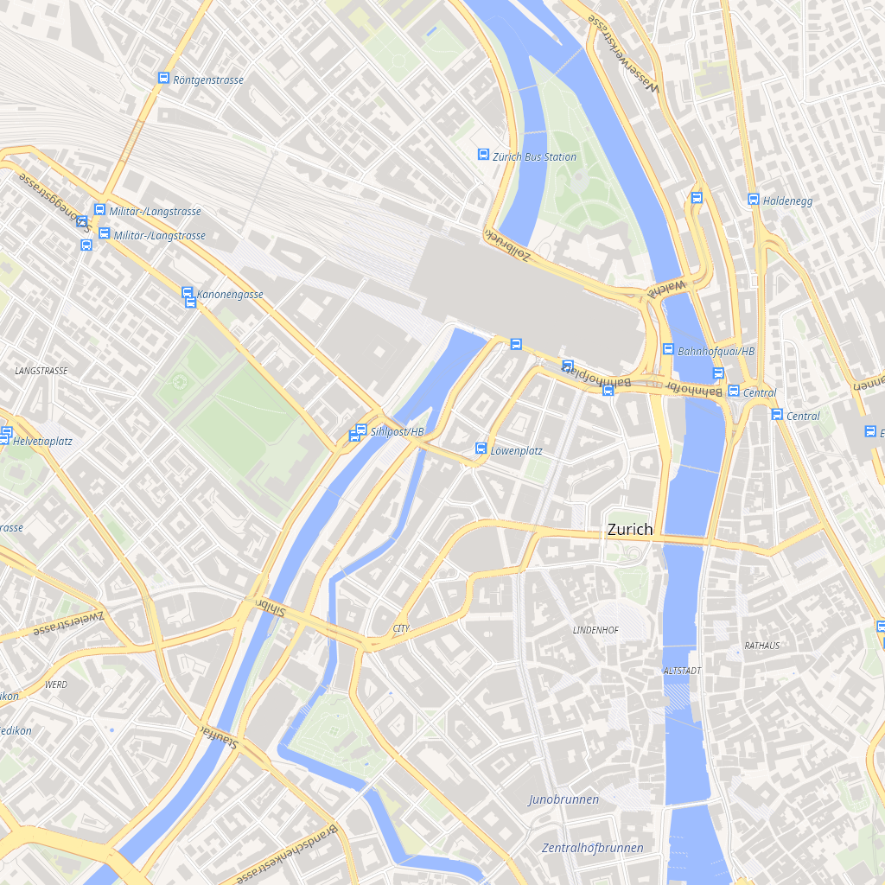
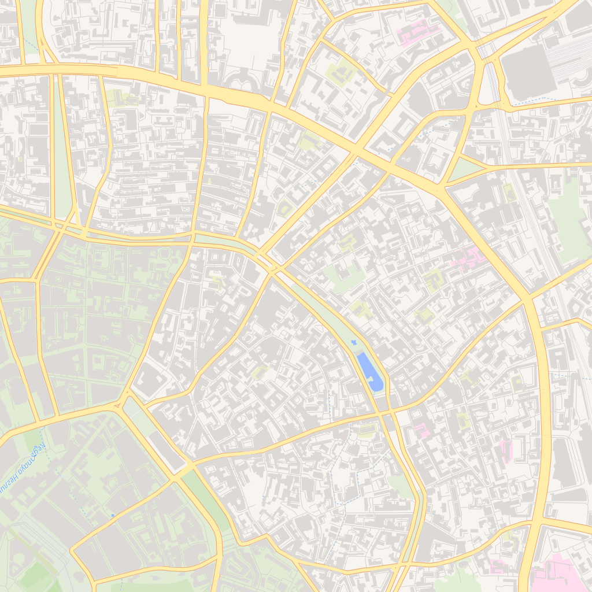
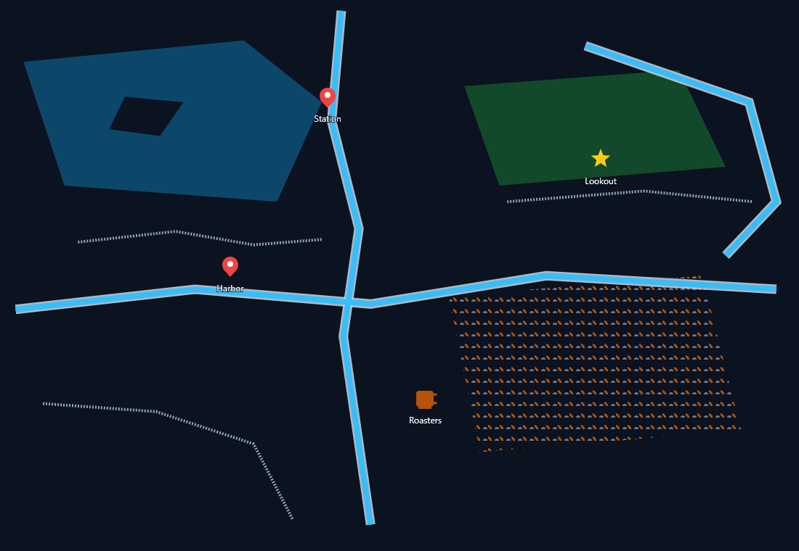
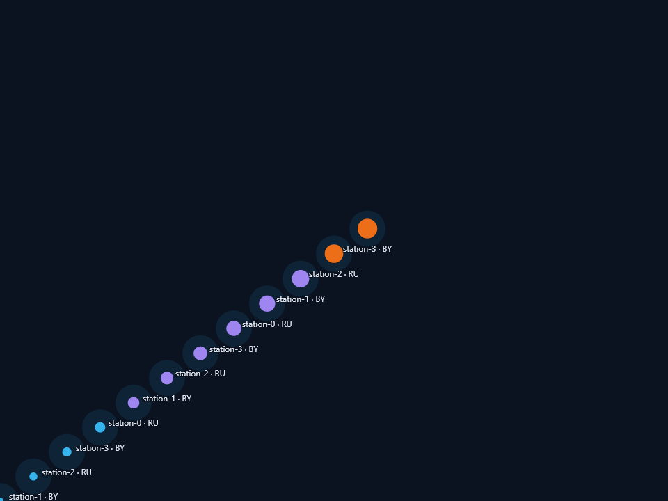
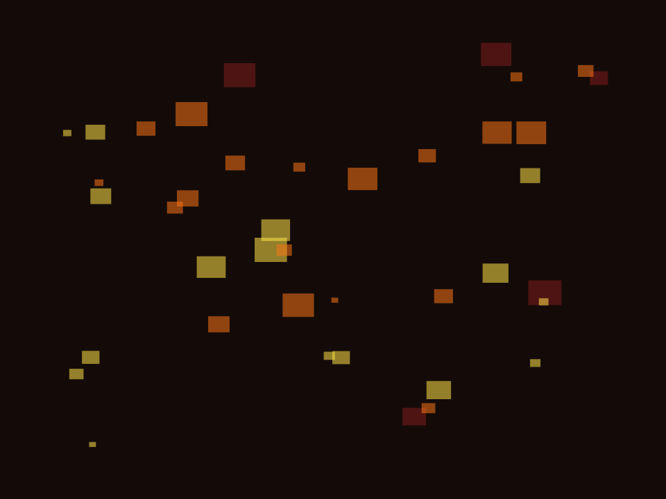
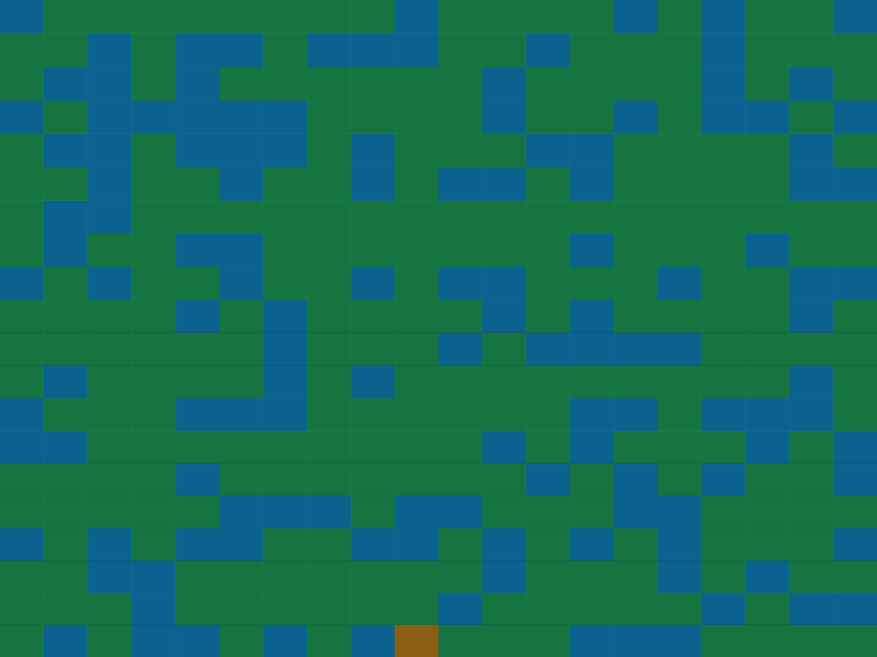

# DP.VectorMapTileRenderer

A .NET vector map tile **reader and renderer**: MapLibre Tile (MLT v1) and Mapbox Vector Tile
(MVT 2.x) decoding, PMTiles/MBTiles archives, GeoJSON, a MapLibre/Mapbox style engine, and a
SkiaSharp canvas that renders a slippy-map tile to an `SKBitmap`.

The library is split into small packages so a project only references the formats it actually
reads, and the core has no external dependencies.

**Target frameworks:** `net8.0` · `net9.0` · `net10.0` · `net11.0`  
**License:** MIT



*Zurich, z14 — real OpenStreetMap data from [OpenFreeMap](https://openfreemap.org/) vector tiles,
rendered with the Liberty style by this library. Map data © OpenStreetMap contributors.*

## Real OpenStreetMap data

| Zurich (z14) | Moscow (z13) |
| --- | --- |
|  |  |

Both tiles come from OpenFreeMap's OpenStreetMap vector tiles and are rendered with the
[Liberty](https://github.com/openmaptiles/maplibre-gl-js?tab=readme-ov-file) style through the
library's style engine (expressions, sprite icons, road casings, text on paths).

### Synthetic feature demo

| Streets, icons and labels | Stations | Fire | Weather |
| --- | --- | --- | --- |
|  |  |  |  |

## Features

- **Vector tiles** — MLT v1 and MVT 2.x, gzip-aware, dependency-free decoders.
- **Archives and documents** — PMTiles v3 (MVT/MLT/PNG/JPEG/WebP/AVIF, gzip/brotli/zstd),
  MBTiles (SQLite, `tiles` and `map`/`images` schemas), GeoJSON (WGS84, Web Mercator, tile-local).
- **MapLibre style engine** — layers, sources, filters, zoom/property `stops`, and a broad subset of
  MapLibre expressions (`case`, `match`, `interpolate`, `step`, `get`, `has`, `coalesce`,
  comparisons, logical operators, `concat`, `to-string`, `to-number`).
- **Rendering** — points, lines and polygons (including holes/multipolygons), fills, strokes,
  dashes, line caps/joins/offsets, backgrounds, raster backgrounds.
- **Symbols** — text with wrapping, transforms, halos, line placement, anchors, rotation,
  collisions; sprite icons with size/rotate/offset/opacity; `fill-pattern`, `line-pattern`,
  `background-pattern`.
- **Big data ready** — range-based PMTiles, indexed MBTiles, STRtree GeoJSON extraction, bounded
  LRU directory cache, overzoom, cancellation tokens, parallel reads.
- **No UI dependency** — output is `SKBitmap`; the renderer is a separate SkiaSharp package.

## Packages

| Package | Contents | External dependencies |
| --- | --- | --- |
| `DP.VectorMapTileRenderer` | model, MLT/MVT readers, style engine, file/raster sources, overzoom | **none** |
| `DP.VectorMapTileRenderer.Skia` | `Renderer`, `SkiaCanvas`, sprite atlas, clipping/offsetting | `SkiaSharp` |
| `DP.VectorMapTileRenderer.Pmtiles` | PMTiles v3 archive reader and tile source | `ZstdSharp.Port` |
| `DP.VectorMapTileRenderer.MbTiles` | MBTiles (SQLite) tile source | `Microsoft.Data.Sqlite` |
| `DP.VectorMapTileRenderer.GeoJson` | GeoJSON tile source and parser | `NetTopologySuite`, `NetTopologySuite.IO.GeoJSON4STJ` |

Each package has its own README with API details.

## Install

```bash
dotnet add package DP.VectorMapTileRenderer          # parsing + styles
dotnet add package DP.VectorMapTileRenderer.Skia     # rendering
dotnet add package DP.VectorMapTileRenderer.Pmtiles  # PMTiles archives
dotnet add package DP.VectorMapTileRenderer.MbTiles  # MBTiles archives
dotnet add package DP.VectorMapTileRenderer.GeoJson  # GeoJSON
```

## Quick start

```csharp
using DP.VectorMapTileRenderer;
using DP.VectorMapTileRenderer.Sources;
using SkiaSharp;

var style = new Style("style.json") { FontDirectory = "fonts" };
style.SetSourceProvider("vector", new FileVectorTileSource("tiles/{z}/{x}/{y}.mlt"));

// Optional: MapLibre sprite atlas for icon-image and patterns.
using var sprite = style.SpriteUrl is { } spriteUrl
    ? await SpriteAtlas.LoadAsync(spriteUrl)
    : null;
using var canvas = new SkiaCanvas { Sprite = sprite };

using var bitmap = await Renderer.RenderAsync(
    style, canvas,
    x: 8579, y: 10645, zoom: 14,
    sizeX: 512, sizeY: 512);

bitmap?.Encode(SKEncodedImageFormat.Png, 100)?.SaveTo("tile.png");
```

Reading a tile without rendering:

```csharp
var bytes = File.ReadAllBytes("tiles/0/0/0.mlt");
var tile = VectorTileReader.Read(bytes); // MLT or MVT auto-detected

// or through a source
using var source = new FileVectorTileSource("tiles/0/0/0.mlt");
var decoded = await source.GetVectorTile(0, 0, 0);
```

### PMTiles

```csharp
using DP.VectorMapTileRenderer.Pmtiles;

using var pmtiles = new PmtilesTileSource("tiles/2026/11/05/12.pmtiles");
style.SetSourceProvider("weather", pmtiles);
```

### MBTiles

```csharp
using DP.VectorMapTileRenderer.MbTiles;

var mbtiles = new MbTilesSource("zurich.mbtiles"); // TMS rows by default
style.SetSourceProvider("vector", mbtiles);
```

### GeoJSON

```csharp
using DP.VectorMapTileRenderer.GeoJson;

var geojson = new GeoJsonTileSource("incidents.geojson") { LayerName = "incidents" };
style.SetSourceProvider("incidents", geojson);

// large documents: load asynchronously
var asyncSource = await GeoJsonTileSource.CreateAsync("world.geojson");
```

## Formats

| Format | Reader | Notes |
| --- | --- | --- |
| MLT v1 | `Mlt.MltTileReader` | Columnar tiles; nullable columns, delta/RLE, dictionaries, topology. |
| MVT 2.x | `Mvt.MvtTileReader` | Protobuf, points/lines/polygons/multi-geometries. |
| PMTiles v3 | `Pmtiles.PmtilesTileSource` | Range reads, MVT/MLT/raster, gzip/brotli/zstd, overzoom. |
| MBTiles | `MbTiles.MbTilesSource` | `tiles` or `map`+`images`, TMS/Slippy, gzip, metadata, overzoom. |
| GeoJSON | `GeoJson.GeoJsonTileSource` | WGS84/WebMercator/tile-local, clipping, STRtree extraction. |
| Raster | `Sources.RasterTileSource` | PNG/JPEG/WebP decoded by SkiaSharp. |

## Rendering capabilities

| MapLibre feature | Status |
| --- | --- |
| fill, line, circle, background, symbol, raster layers | yes |
| polygons with holes, multipolygons | yes (single even-odd path per feature) |
| line width/color/opacity/cap/join/dash/offset | yes |
| text field, font, size, color, halo, wrap, transform, offset | yes |
| text anchor, rotation, line height, padding, line placement, collisions | yes |
| sprite icons, icon size/rotate/offset/opacity | yes |
| fill/line/background patterns | yes (sprite-based) |
| filters and zoom/property stops | yes |
| expressions (`case`, `match`, `interpolate`, `step`, `get`, ...) | yes |
| PBF/SDF glyph atlases (`glyphs`) | no — uses TTF/OTF files |
| `text-letter-spacing`, `text-keep-upright`, `line-gradient`, `symbol-sort-key` | no |

## Performance notes

Measured on a typical developer machine (.NET 11, Release):

- **MBTiles** — 1,000,000 tiles, 5,000 random lookups: ~67 µs/query average, ~111 µs p99.
- **GeoJSON** — 200,000 features (~21 MB): ~1.5 s parse, ~0.2 ms per tile average.
- **PMTiles** — tile data at a virtual 3 GB offset: range-read overhead below 1 µs (real disk/network
  I/O is additional).

Large-archive safeguards: range reads and `long` offsets, bounded 256-entry LRU for PMTiles leaf
directories, section-bound validation, explicit corrupt-directory errors, indexed MBTiles lookups
(`HasTileIndex`), and an STRtree for GeoJSON.

## Thread safety

Sources (`FileVectorTileSource`, `PmtilesTileSource`, `MbTilesSource`, `GeoJsonTileSource`) are safe
for concurrent reads. `Style` is read-only after construction. `SkiaCanvas` is a per-render object
and is not thread-safe — use one canvas per concurrent render. Library `await`s use
`ConfigureAwait(false)`.

## Build and test

```bash
dotnet build DP.VectorMapTileRenderer.slnx   # or reference the projects directly
dotnet test tests/DP.VectorMapTileRenderer.Tests
```

The test suite runs on every target framework and covers golden MLT/MVT tiles, PMTiles/MBTiles/
GeoJSON, style expressions, sprite icons, polygon holes, overzoom, large offsets and concurrent
reads.

## Publishing

NuGet publishing uses **Trusted Publishing (OIDC)** — no long-lived API key.

1. On nuget.org, create a Trusted Publishing policy:
   - Repository Owner: `DenisPolagaev`
   - Repository: `DP.VectorMapTileRenderer`
   - Workflow File: `nuget.yml`
   - Environment: leave empty (or add `environment: <name>` to the `publish` job and use the same name)
2. Add the GitHub Actions secret `NUGET_USER` with your nuget.org **username (profile name)**, not email.
3. Push a `v*` tag or run the `nuget` workflow manually with `publish=true`.

The workflow requests a short-lived API key through `NuGet/login@v1` and pushes `.nupkg` + `.snupkg`.

## License

MIT. See [LICENSE](LICENSE).
