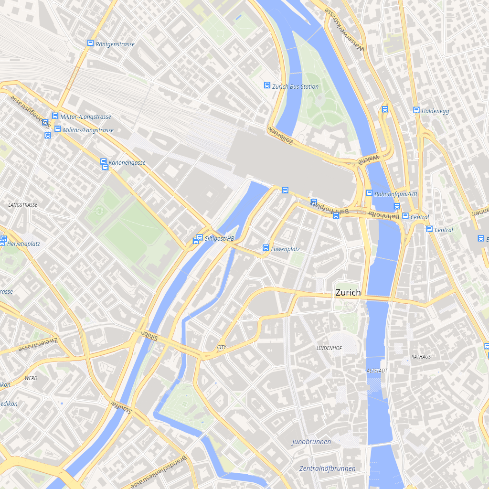

# DP.VectorMapTileRenderer.Skia

SkiaSharp renderer for `DP.VectorMapTileRenderer`: draws a vector tile with a MapLibre/Mapbox
style onto an `SKBitmap`.



## Install

```bash
dotnet add package DP.VectorMapTileRenderer.Skia
```

Depends on `DP.VectorMapTileRenderer` and `SkiaSharp`.

## Render a tile

```csharp
using DP.VectorMapTileRenderer;
using DP.VectorMapTileRenderer.Sources;

var style = new Style("style.json") { FontDirectory = "fonts" };
style.SetSourceProvider("vector", new FileVectorTileSource("tiles/{z}/{x}/{y}.mlt"));

using var sprite = style.SpriteUrl is { } spriteUrl
    ? await SpriteAtlas.LoadAsync(spriteUrl)
    : null;
using var canvas = new SkiaCanvas { Sprite = sprite };

using var bitmap = await Renderer.RenderAsync(
    style, canvas, x: 8579, y: 10645, zoom: 14, sizeX: 512, sizeY: 512);
```

`Renderer.RenderCachedAsync(cachePath, ...)` caches the PNG.

## Rendering support

- fill, line, circle, background, symbol, raster layers;
- polygon holes and multipolygons as one even-odd path;
- line width/color/opacity/cap/join/dash/offset;
- text fields, fonts, sizes, colors, halos, wrapping, transforms, anchors, rotation, line height,
  padding, line placement and collision detection;
- sprite icons (`icon-image`, size/rotate/offset/opacity) via `SpriteAtlas`;
- sprite-based `fill-pattern`, `line-pattern`, `background-pattern`;
- overzoom clipping via `VectorTile.IsOverZoomed`.

## Sprite atlas

```csharp
using var sprite = SpriteAtlas.FromFiles("sprite.json", "sprite.png");
canvas.Sprite = sprite;
```

`SpriteAtlas.LoadAsync("https://…/sprite")` loads `sprite.json` + `sprite.png` over HTTP.
The atlas owns the image and shader cache; dispose it after the canvas.

## Text

Text uses TTF/OTF files from `Style.FontDirectory` (family-name lookup). PBF/SDF glyph atlases are
not supported.

## Thread safety

`SkiaCanvas` is a per-render object and is not thread-safe. Use one canvas per concurrent render.

## License

MIT.
